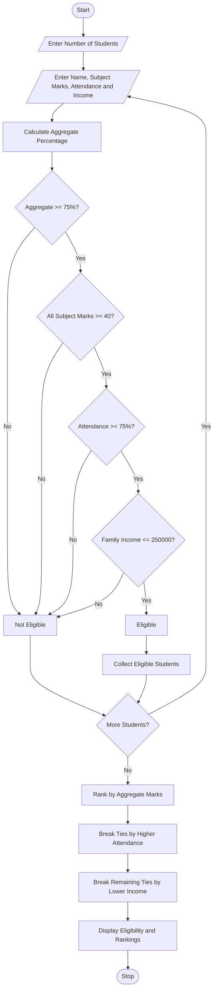

# 1. University Scholarship Allocation System Using Python

## 1. Problem Statement

The University Scholarship Allocation System is designed to evaluate student applications based on aggregate marks, subject-wise minimum marks, attendance percentage, and annual family income.

The system checks whether each student satisfies all the scholarship eligibility criteria. Eligible students are ranked according to their aggregate marks. If two students have the same aggregate marks, the system uses predefined tie-breaking rules:

1. Higher aggregate marks receive a higher rank.
2. If aggregate marks are equal, higher attendance receives a higher rank.
3. If both aggregate marks and attendance are equal, lower annual family income receives a higher rank.
4. If all three criteria are equal, the student whose name comes first alphabetically receives a higher rank.

Finally, the system displays the eligible students in rank order and identifies students who do not satisfy the eligibility criteria.

### Scholarship Eligibility Criteria

| Criterion | Requirement |
|---|---|
| Aggregate marks | At least 75% |
| Minimum marks in each subject | At least 60% |
| Attendance | At least 75% |
| Annual family income | Not more than ₹2,50,000 |

*Note: These are example criteria for this project. Actual scholarship rules may differ.*

## 2. Algorithm

**Step 1:** Start the program.

**Step 2:** Read the number of student applicants.

**Step 3:** For each student, input:
- Student name
- Aggregate marks percentage
- Marks percentage in each subject
- Attendance percentage
- Annual family income

**Step 4:** Check the eligibility conditions:
- Aggregate marks ≥ 75%
- Every subject mark ≥ 60%
- Attendance ≥ 75%
- Annual family income ≤ ₹2,50,000

**Step 5:** If all conditions are satisfied, add the student to the eligible list. Otherwise, display the reason for ineligibility.

**Step 6:** Sort eligible students using these ranking rules:
- Aggregate marks in descending order.
- Attendance in descending order.
- Annual family income in ascending order.
- Student name in alphabetical order.

**Step 7:** Assign ranks to the eligible students.

**Step 8:** Display the eligible students, their marks, attendance, income, and ranks.

**Step 9:** Display the ineligible students and their reasons.

**Step 10:** Stop the program.


## 5. Sample Input

Consider three students: Ravi, Sita, and Arjun.

```text
Enter number of students: 3

Enter details of Student 1
Enter student name: Ravi
Enter aggregate marks (%): 85
Enter marks in Subject 1 (%): 80
Enter marks in Subject 2 (%): 85
Enter marks in Subject 3 (%): 90
Enter attendance (%): 90
Enter annual family income (Rs.): 200000

Enter details of Student 2
Enter student name: Sita
Enter aggregate marks (%): 85
Enter marks in Subject 1 (%): 85
Enter marks in Subject 2 (%): 90
Enter marks in Subject 3 (%): 80
Enter attendance (%): 95
Enter annual family income (Rs.): 180000

Enter details of Student 3
Enter student name: Arjun
Enter aggregate marks (%): 65
Enter marks in Subject 1 (%): 60
Enter marks in Subject 2 (%): 70
Enter marks in Subject 3 (%): 65
Enter attendance (%): 80
Enter annual family income (Rs.): 150000
```

## 6. Sample Output

```text
===== SCHOLARSHIP RANK LIST =====

Rank: 1
Name: Sita
Aggregate: 85.0 %
Attendance: 95.0 %
Annual Family Income: Rs. 180000.0

Rank: 2
Name: Ravi
Aggregate: 85.0 %
Attendance: 90.0 %
Annual Family Income: Rs. 200000.0

===== INELIGIBLE STUDENTS =====

Name: Arjun
Reasons:
- Aggregate marks below 75%
```

### Result Analysis

- **Sita receives Rank 1** because her aggregate marks are equal to Ravi's, but her attendance is higher.
- **Ravi receives Rank 2** because his aggregate marks are equal to Sita's, but his attendance is lower.
- **Arjun is ineligible** because his aggregate marks are below 75%.

Both Sita and Ravi satisfy the subject-wise minimum marks, attendance, and income criteria.

---
## 7.Mermaid Flowchart Code

## 8. Conclusion

The University Scholarship Allocation System automates the process of evaluating student scholarship applications. It checks eligibility using aggregate marks, subject-wise minimum marks, attendance, and family income. It ranks eligible students using predefined tie-breaking rules and explains why other applicants are ineligible. This system reduces manual work, improves consistency, and makes scholarship allocation easier to manage.
