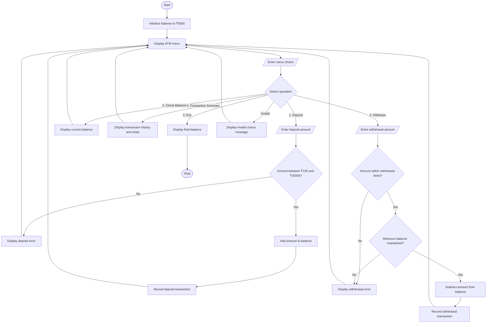

# ATM Menu-Driven Banking Simulation


## 1. Problem Statement

Develop an ATM Menu-Driven Banking Simulation that allows users to perform repeated banking operations, including deposits, withdrawals, balance inquiries, and transaction summaries. The system validates user inputs, enforces account balance and transaction limits, maintains a transaction history, and displays the final account summary when the user exits.

Rules used in this project:

- Initial account balance: ₹5,000.
- Minimum deposit: ₹100 per transaction.
- Maximum deposit: ₹25,000 per transaction.
- Minimum withdrawal: ₹100 per transaction.
- Maximum withdrawal: ₹10,000 per transaction.
- Minimum balance: ₹500 must remain after a withdrawal.
- Invalid amounts and insufficient balances must be rejected.
- The menu repeats until the user selects Exit.

These are example limits for an academic simulation, not actual bank policies.

## 2. Algorithm

1. Start the program.
2. Initialize the account balance to ₹5,000 and create an empty transaction history.
3. Display the ATM menu:
   - Deposit
   - Withdraw
   - Check Balance
   - Transaction Summary
   - Exit
4. Ask the user to select an operation.
5. If Deposit is selected, validate the amount and deposit it if it meets the limits.
6. If Withdraw is selected, validate the amount, check the withdrawal limit and ensure the minimum balance remains.
7. If Check Balance is selected, display the current balance.
8. If Transaction Summary is selected, display all transactions and the transaction totals.
9. If Exit is selected, display the final balance and terminate the program.
10. For invalid menu choices or amounts, display an appropriate error message.
11. Repeat the menu until Exit is selected.


## 5. Sample Input

This example demonstrates a deposit, a withdrawal, a balance inquiry, a transaction summary, and exit.

```
Enter your choice (1-5): 1
Enter deposit amount: ₹2000

Enter your choice (1-5): 2
Enter withdrawal amount: ₹1500

Enter your choice (1-5): 3

Enter your choice (1-5): 4

Enter your choice (1-5): 5
```

## 6. Sample Output

```
========== ATM MENU ==========
1. Deposit
2. Withdraw
3. Check Balance
4. Transaction Summary
5. Exit
==============================
Enter your choice (1-5): 1
Enter deposit amount: ₹2000
Deposit successful: ₹2000.00
Current balance: ₹7000.00

========== ATM MENU ==========
1. Deposit
2. Withdraw
3. Check Balance
4. Transaction Summary
5. Exit
==============================
Enter your choice (1-5): 2
Enter withdrawal amount: ₹1500
Withdrawal successful: ₹1500.00
Current balance: ₹5500.00

========== ATM MENU ==========
1. Deposit
2. Withdraw
3. Check Balance
4. Transaction Summary
5. Exit
==============================
Enter your choice (1-5): 3
Current account balance: ₹5500.00

========== ATM MENU ==========
1. Deposit
2. Withdraw
3. Check Balance
4. Transaction Summary
5. Exit
==============================
Enter your choice (1-5): 4

====== TRANSACTION SUMMARY ======
1. Deposit: ₹2000.00 | Balance: ₹7000.00
2. Withdrawal: ₹1500.00 | Balance: ₹5500.00
---------------------------------
Total deposits:    ₹2000.00
Total withdrawals: ₹1500.00
Current balance:   ₹5500.00
=================================

========== ATM MENU ==========
1. Deposit
2. Withdraw
3. Check Balance
4. Transaction Summary
5. Exit
==============================
Enter your choice (1-5): 5

Thank you for using the ATM.
Final account balance: ₹5500.00
Session ended.
```

## 7. Mermaid Flowchart Code for GitHub README



## 8. Important Python Concepts

| Concept        | Purpose                                                      |
| -------------- | ------------------------------------------------------------ |
| `while True`   | Repeats the ATM menu                                         |
| `if-elif-else` | Selects the banking operation                                |
| `try-except`   | Handles invalid numeric inputs                               |
| Variables      | Store the balance and transaction totals                     |
| Lists          | Store transaction history                                    |
| Tuples         | Store each transaction's type, amount, and remaining balance |
| `break`        | Exits the menu loop                                          |
| `:.2f`         | Displays monetary amounts with two decimal places            |

## 9. Conclusion

The ATM Menu-Driven Banking Simulation supports deposits, withdrawals, balance inquiries, and transaction summaries. It validates amounts, enforces account limits, maintains transaction history, and displays the final balance. This project demonstrates Python loops, conditional statements, lists, tuples, exception handling, and formatted output.
