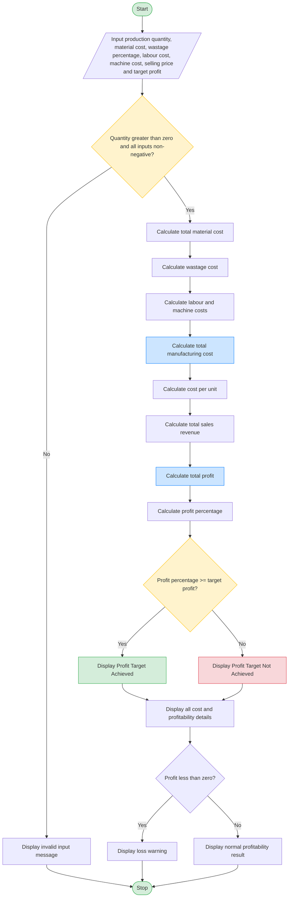

# 2. Manufacturing Cost and Profitability Analysis Using Python

## 1. Problem Statement

The Manufacturing Cost and Profitability Analysis System is designed to calculate the total manufacturing cost and profit earned by producing a product.

The system accepts the cost of raw materials, labour charges, wastage percentage, machine operating costs, quantity produced, selling price per unit, and the required profit target.

It calculates the material wastage cost, total production cost, cost per unit, total sales revenue, actual profit, and profit percentage. Finally, it determines whether the production process meets the specified profit target.

### Objectives
- Calculate the total cost of raw materials.
- Calculate material wastage costs.
- Calculate labour and machine operating costs.
- Determine the total manufacturing cost and cost per unit.
- Calculate total sales revenue and profit.
- Check whether the actual profit meets the specified target.

### Formulas

| Calculation | Formula |
|---|---|
| Material cost | Quantity × Material cost per unit |
| Wastage cost | Material cost × Wastage percentage / 100 |
| Total labour cost | Quantity × Labour cost per unit |
| Total machine cost | Quantity × Machine cost per unit |
| Total manufacturing cost | Material cost + Wastage cost + Labour cost + Machine cost |
| Cost per unit | Total manufacturing cost / Quantity |
| Total sales revenue | Quantity × Selling price per unit |
| Total profit | Total sales revenue − Total manufacturing cost |
| Profit percentage | (Total profit / Total manufacturing cost) × 100 |

**Profit target:** The production meets the target if the actual profit percentage is greater than or equal to the specified target percentage.

## 2. Algorithm

**Step 1:** Start the program.

**Step 2:** Input the production quantity, material cost per unit, wastage percentage, labour cost per unit, machine cost per unit, selling price per unit, and target profit percentage.

**Step 3:** Calculate the total material cost.

**Step 4:** Calculate the material wastage cost using the specified wastage percentage.

**Step 5:** Calculate the total labour cost and total machine operating cost.

**Step 6:** Calculate the total manufacturing cost by adding material cost, wastage cost, labour cost, and machine cost.

**Step 7:** Calculate the manufacturing cost per unit.

**Step 8:** Calculate total sales revenue using the production quantity and selling price per unit.

**Step 9:** Calculate actual profit by subtracting total manufacturing cost from total sales revenue.

**Step 10:** Calculate the profit percentage.

**Step 11:** Compare the actual profit percentage with the target profit percentage.
- If the actual profit percentage is greater than or equal to the target, display **"Profit target achieved."**
- Otherwise, display **"Profit target not achieved."**

**Step 12:** Display all cost details, revenue, profit, and the target result.

**Step 13:** Stop the program.

## 5. Sample Input

```text
Enter production quantity: 100
Enter material cost per unit (Rs.): 200
Enter wastage percentage: 5
Enter labour cost per unit (Rs.): 50
Enter machine cost per unit (Rs.): 30
Enter selling price per unit (Rs.): 350
Enter target profit percentage: 20
```

## 6. Sample Output

```text
===== MANUFACTURING COST ANALYSIS =====
Material Cost: Rs. 20000.00
Wastage Cost: Rs. 1000.00
Labour Cost: Rs. 5000.00
Machine Cost: Rs. 3000.00
Total Manufacturing Cost: Rs. 29000.00
Cost Per Unit: Rs. 290.00
Total Sales Revenue: Rs. 35000.00
Total Profit: Rs. 6000.00
Profit Percentage: 20.69%
Target Profit Percentage: 20.00%

===== PROFITABILITY RESULT =====
Profit target achieved.
```

### Calculation Verification

| Particulars | Amount |
|---|---:|
| Material cost | ₹20,000 |
| Wastage cost (5%) | ₹1,000 |
| Labour charges | ₹5,000 |
| Machine costs | ₹3,000 |
| **Total manufacturing cost** | **₹29,000** |
| Total sales revenue | ₹35,000 |
| **Total profit** | **₹6,000** |
| Profit percentage | 20.69% |
| Target profit percentage | 20% |
| Final result | Profit target achieved |

**Result:** The total manufacturing cost is ₹29,000, and the total profit is ₹6,000. The profit percentage is 20.69%, which exceeds the target of 20%. Therefore, the production meets the specified profit target.

---

## 7. Mermaid Flowchart Code


## 8. Conclusion

The Manufacturing Cost and Profitability Analysis System calculates material costs, wastage, labour charges, machine costs, total manufacturing expenses, sales revenue, and profit. It compares the actual profit percentage with the specified target to determine whether production is profitable enough to meet the business objective. This system helps manufacturers estimate costs, monitor profitability, and make better production and pricing decisions.
