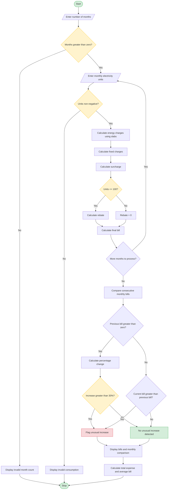

# 3. Progressive Electricity Billing System Using Python

## 1. Problem Statement

The Progressive Electricity Billing System is designed to calculate household electricity bills based on electricity consumption across multiple pricing slabs. The system considers energy charges, fixed charges, surcharges, and rebates to determine the final monthly bill.

It accepts electricity consumption data for several months, calculates each month's bill, compares bills across months, and identifies unusual increases in electricity expenses.

The system uses progressive billing, meaning that different rates apply to different portions of electricity consumption.

### Objectives
- Calculate electricity charges using multiple consumption slabs.
- Add fixed charges and applicable surcharges.
- Apply rebates to eligible bills.
- Calculate the final electricity bill for each month.
- Compare monthly bills and identify unusual increases.
- Display a summary of monthly electricity expenses.

### Example Electricity Tariff

The following tariff is used for this project. These are illustrative rates, not official electricity tariffs.

| Consumption Slab | Rate per Unit |
|---|---:|
| First 100 units | ₹2.00 |
| Next 100 units (101–200) | ₹3.00 |
| Next 100 units (201–300) | ₹5.00 |
| Above 300 units | ₹7.00 |

**Additional charges:**
- Fixed charge: ₹50 per month
- Surcharge: 5% of energy charges
- Rebate: 10% of energy charges when consumption is at most 100 units
- Unusual increase: Final bill increases by more than 30% compared with the previous month

---

## 2. Algorithm

**Step 1:** Start the program.

**Step 2:** Input the number of months to be analyzed.

**Step 3:** For each month, input the electricity consumption in units.

**Step 4:** Calculate energy charges using the progressive slabs:
- First 100 units at ₹2 per unit.
- Next 100 units at ₹3 per unit.
- Next 100 units at ₹5 per unit.
- Remaining units at ₹7 per unit.

**Step 5:** Add the fixed monthly charge of ₹50.

**Step 6:** Calculate the surcharge as 5% of the energy charges.

**Step 7:** If consumption is at most 100 units, calculate a rebate of 10% of the energy charges. Otherwise, the rebate is zero.

**Step 8:** Calculate the final bill using:

Final Bill = Energy Charges + Fixed Charges + Surcharge − Rebate

**Step 9:** Store the monthly consumption and bill amount.

**Step 10:** Compare each month's bill with the previous month's bill.

**Step 11:** Calculate the percentage increase using:

Percentage Increase = ((Current Bill − Previous Bill) / Previous Bill) × 100

**Step 12:** If the increase exceeds 30%, identify the bill as having an unusual increase. Otherwise, report that no unusual increase was detected.

**Step 13:** Display the monthly bills, energy charges, surcharges, rebates, and comparison results.

**Step 14:** Stop the program.

#

## 5. Sample Input

```text
Enter number of months: 3

Month 1
Enter electricity consumption (units): 80

Month 2
Enter electricity consumption (units): 120

Month 3
Enter electricity consumption (units): 250
```

## 6. Sample Output

```text
===== MONTHLY ELECTRICITY BILLS =====

Month: 1
Units Consumed: 80.00
Energy Charges: Rs. 160.00
Fixed Charges: Rs. 50.00
Surcharge: Rs. 8.00
Rebate: Rs. 16.00
Final Bill: Rs. 202.00

Month: 2
Units Consumed: 120.00
Energy Charges: Rs. 260.00
Fixed Charges: Rs. 50.00
Surcharge: Rs. 13.00
Rebate: Rs. 0.00
Final Bill: Rs. 323.00

Month: 3
Units Consumed: 250.00
Energy Charges: Rs. 750.00
Fixed Charges: Rs. 50.00
Surcharge: Rs. 37.50
Rebate: Rs. 0.00
Final Bill: Rs. 837.50

===== MONTHLY BILL COMPARISON =====

Month 1 to Month 2:
Percentage Change: 59.90%
Unusual increase detected!

Month 2 to Month 3:
Percentage Change: 159.29%
Unusual increase detected!

===== SUMMARY =====
Number of Months: 3
Total Electricity Expense: Rs. 1362.50
Average Monthly Bill: Rs. 454.17
```

### Result Analysis

| Month | Units Consumed | Final Bill | Bill Change |
|---|---:|---:|---:|
| Month 1 | 80 | ₹202.00 | — |
| Month 2 | 120 | ₹323.00 | 59.90% increase |
| Month 3 | 250 | ₹837.50 | 159.29% increase |

- **Month 1:** The bill is ₹202 after applying the rebate.
- **Month 2:** The bill increases by 59.90%, exceeding the 30% threshold.
- **Month 3:** The bill increases by 159.29%, also exceeding the threshold.
- **Total expense:** ₹1,362.50 for three months.

Therefore, the system identifies unusual increases in both Month 2 and Month 3.

---

## 7. Mermaid Flowchart Code


## 8. Conclusion

The Progressive Electricity Billing System calculates household electricity bills using multiple consumption slabs, fixed charges, surcharges, and rebates. It compares bills across several months and identifies unusual increases when the bill rises by more than the specified threshold of 30%. This system helps households understand their electricity expenses, monitor consumption costs, and identify months that may require further investigation.
