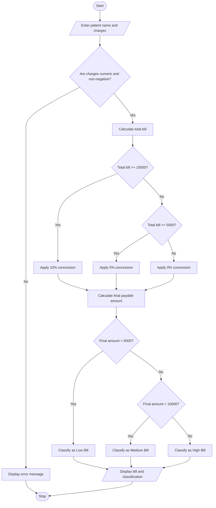

## 1. Problem Statement

Design a Hospital Billing and Patient Classification System that calculates the total bill for each patient based on consultation charges, diagnostic charges, and treatment charges. The system applies conditional concessions based on patient eligibility, validates billing constraints such as negative charges and invalid inputs, and classifies patients according to their final payable amount and payment policy.

**Billing rules used in this example:**
- Consultation, diagnostic, and treatment charges are entered separately.
- Charges must be non-negative.
- Patients with bills of ₹10,000 or more receive a 10% concession.
- Patients with bills of ₹5,000–₹9,999.99 receive a 5% concession.
- Bills below ₹5,000 receive no concession.
- Patients are classified according to their final payable amount:
  - **Low Bill:** Below ₹5,000
  - **Medium Bill:** ₹5,000–₹9,999.99
  - **High Bill:** ₹10,000 or above

*Note: These are example rules for an academic project, not an actual hospital's billing policy.*

## 2. Algorithm

1. Start the program.
2. Enter the patient's name.
3. Enter consultation charges.
4. Enter diagnostic charges.
5. Enter treatment charges.
6. Validate the inputs:
   - Charges must be numeric.
   - Charges must not be negative.
7. Calculate the total bill by adding consultation, diagnostic, and treatment charges.
8. Apply the concession:
   - If the total bill is ₹10,000 or more, apply a 10% concession.
   - Otherwise, if the total bill is ₹5,000 or more, apply a 5% concession.
   - Otherwise, apply no concession.
9. Calculate the final payable amount by subtracting the concession from the total bill.
10. Classify the patient according to the final payable amount:
    - Below ₹5,000: Low Bill.
    - ₹5,000 to below ₹10,000: Medium Bill.
    - ₹10,000 or more: High Bill.
11. Display the patient's name, total bill, concession, final payable amount, and classification.
12. Stop the program.

### 5. Sample Input

```text
Enter patient name: Ravi
Enter consultation charges: ₹1000
Enter diagnostic charges: ₹3000
Enter treatment charges: ₹7000
```

### 6. Sample Output

```text
====== HOSPITAL BILL ======
Patient Name: Ravi
Consultation Charges: ₹1000.00
Diagnostic Charges:   ₹3000.00
Treatment Charges:    ₹7000.00
---------------------------
Total Bill:           ₹11000.00
Concession Rate:      10%
Concession Amount:    ₹1100.00
Final Payable Amount: ₹9900.00
Patient Classification: Medium Bill
===========================
```

### 7. Calculation

**Step 1: Calculate the total bill**

Total Bill = Consultation + Diagnostics + Treatment

= ₹1,000 + ₹3,000 + ₹7,000

= **₹11,000**

**Step 2: Calculate the concession**

Since the total bill is at least ₹10,000, the concession rate is 10%.

Concession = ₹11,000 × 10 / 100

= **₹1,100**

**Step 3: Calculate the final payable amount**

Final Amount = Total Bill − Concession

= ₹11,000 − ₹1,100

= **₹9,900**

**Step 4: Classify the patient**

The final payable amount is ₹9,900, which is between ₹5,000 and ₹10,000.

Therefore, the classification is **Medium Bill**.

## 8. Mermaid Flowchart Code


## 9. Conclusion

The Hospital Billing and Patient Classification System calculates consultation, diagnostic, and treatment charges, applies conditional concessions, validates billing inputs, and classifies patients based on their final payable amounts. This project demonstrates the practical use of Python variables, arithmetic operations, conditional statements, input validation, and formatted output.
