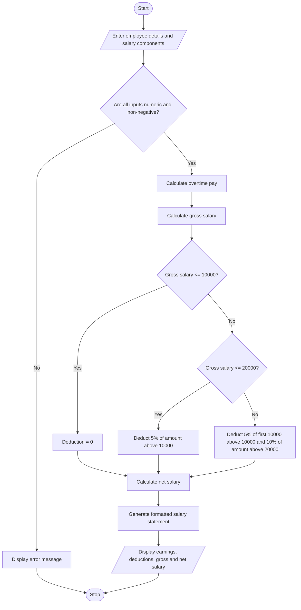

# Employee Payroll and Deduction Analysis


## 1. Problem Statement

Develop an Employee Payroll and Deduction Analysis System that calculates an employee's gross salary using basic pay, allowances, overtime payments, and incentives. The system applies progressive deductions based on predefined salary slabs, calculates the net salary, validates input constraints, and generates a formatted salary statement showing all earnings, deductions, and the final amount payable.

**Rules used in this example:**

**Earnings:**
- Gross Salary = Basic Pay + Allowances + Overtime Pay + Incentives.
- Overtime Pay = Overtime Hours × Overtime Rate per Hour.

**Progressive deductions:**

| Gross Salary Slab | Deduction Rate |
|---|---:|
| First ₹10,000 | 0% |
| Next ₹10,000 (₹10,001–₹20,000) | 5% |
| Amount above ₹20,000 | 10% |

The deduction is calculated progressively, meaning each rate applies only to the portion of salary within that slab.

**Net Salary = Gross Salary − Total Deductions**

*Note: These are illustrative rules for an academic project, not actual statutory payroll or income-tax rates.*

## 2. Algorithm

1. Start the program.
2. Enter the employee's name and employee ID.
3. Enter basic pay, allowances, overtime hours, overtime rate, and incentives.
4. Validate all inputs to ensure they are numeric and non-negative.
5. Calculate overtime pay:

   Overtime Pay = Overtime Hours × Overtime Rate
6. Calculate gross salary:

   Gross Salary = Basic Pay + Allowances + Overtime Pay + Incentives
7. Calculate progressive deductions:
   - If gross salary is ₹10,000 or less, deduction is 0%.
   - If gross salary is between ₹10,000 and ₹20,000, apply 5% to the portion exceeding ₹10,000.
   - If gross salary exceeds ₹20,000, apply 5% to the first ₹10,000 above ₹10,000 and 10% to the portion exceeding ₹20,000.
8. Calculate net salary:

   Net Salary = Gross Salary − Total Deductions
9. Generate a formatted salary statement.
10. Display the employee details, earnings, deductions, gross salary, and net salary.
11. Stop the program.


## 5. Sample Input

```text
Enter Employee ID: EMP101
Enter Employee Name: Ravi
Enter Basic Pay: ₹18000
Enter Allowances: ₹3000
Enter Overtime Hours: 10
Enter Overtime Rate per Hour: ₹200
Enter Incentives: ₹2000
```

## 6. Sample Output

```text
========================================
          EMPLOYEE SALARY SLIP
========================================
Employee ID:        EMP101
Employee Name:      Ravi
----------------------------------------
                 EARNINGS
----------------------------------------
Basic Pay:          ₹18,000.00
Allowances:         ₹3,000.00
Overtime Pay:       ₹2,000.00
Incentives:         ₹2,000.00
----------------------------------------
Gross Salary:       ₹25,000.00
----------------------------------------
                DEDUCTIONS
----------------------------------------
Total Deduction:    ₹1,000.00
----------------------------------------
NET SALARY:         ₹24,000.00
========================================
```

## 7. Calculation

### Step 1: Calculate overtime pay

Overtime Pay = Overtime Hours × Overtime Rate

= 10 × ₹200

= **₹2,000**

### Step 2: Calculate gross salary

Gross Salary = Basic Pay + Allowances + Overtime Pay + Incentives

= ₹18,000 + ₹3,000 + ₹2,000 + ₹2,000

= **₹25,000**

### Step 3: Calculate progressive deductions

The gross salary is ₹25,000.

- First ₹10,000: No deduction.
- Next ₹10,000: 5% deduction = ₹500.
- Remaining ₹5,000: 10% deduction = ₹500.

Total Deduction = ₹500 + ₹500 = **₹1,000**

### Step 4: Calculate net salary

Net Salary = Gross Salary − Total Deduction

= ₹25,000 − ₹1,000

= **₹24,000**

Therefore, the employee's final net salary is **₹24,000**.

## 8. Mermaid Flowchart Code 


## 9. Conclusion

The Employee Payroll and Deduction Analysis System calculates gross salary using basic pay, allowances, overtime, and incentives. It applies progressive deductions, validates input values, calculates net salary, and generates a formatted salary statement. This project demonstrates Python input handling, arithmetic operations, conditional statements, exception handling, and formatted output.
