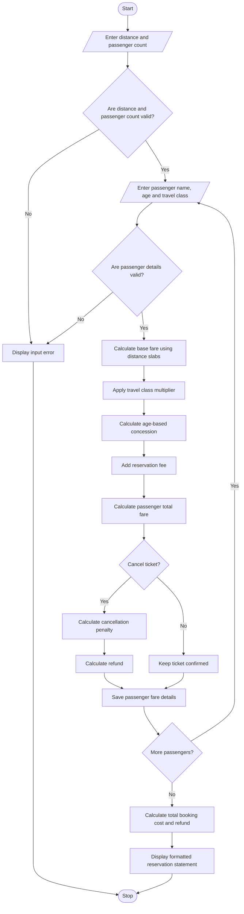

## 1. Problem Statement

Develop a Railway Fare and Reservation Calculator that calculates ticket fares for multiple passengers based on travel distance, travel class, age-based concessions, reservation fees, and cancellation penalties. The system should apply distance-based fare slabs, calculate individual passenger fares, validate passenger details, generate the total reservation cost, and calculate refunds when tickets are cancelled according to a specified cancellation policy.

**Rules used in this example:**

**Distance-based base fare:**
- First 100 km: ₹1.50 per km.
- Next 200 km (101–300 km): ₹1.25 per km.
- Distance above 300 km: ₹1.00 per km.

**Travel class multipliers:**

| Travel Class | Multiplier |
|---|---:|
| Sleeper | 1.0× |
| AC 3 Tier | 2.0× |
| AC 2 Tier | 3.0× |
| AC First Class | 4.0× |

**Age-based concessions:**
- Children below 5 years: Free fare.
- Passengers aged 5–11 years: 50% concession on base travel fare.
- Passengers aged 60 years or older: 40% concession on base travel fare.
- Other passengers: No concession.

**Additional charges and cancellation policy:**
- Reservation fee: ₹40 per passenger.
- Cancellation penalty: 25% of the passenger's payable fare, excluding the reservation fee.
- The reservation fee is non-refundable.
- Cancellation refund = Total amount paid − Cancellation penalty − Non-refundable reservation fee.

*These are hypothetical rules for an academic project and do not represent actual railway fares or current railway concession policies.*

## 2. Algorithm

1. Start the program.
2. Enter the travel distance in kilometres.
3. Enter the number of passengers.
4. For each passenger:
   - Enter the passenger's name and age.
   - Select the travel class.
   - Validate the passenger details.
5. Calculate the base fare using distance slabs:
   - First 100 km at ₹1.50 per km.
   - Next 200 km at ₹1.25 per km.
   - Remaining distance at ₹1.00 per km.
6. Apply the travel class multiplier.
7. Apply the age-based concession:
   - Below 5 years: Free travel fare.
   - 5–11 years: 50% concession.
   - 60 years or older: 40% concession.
   - Other passengers: No concession.
8. Add the reservation fee of ₹40 per passenger.
9. Calculate the total reservation cost for all passengers.
10. Ask whether each passenger's ticket should be cancelled.
11. If cancelled, calculate the cancellation penalty and refund according to the specified policy.
12. Display each passenger's fare, concession, reservation fee, cancellation penalty, and refund.
13. Display the total reservation cost and total refund.
14. Stop the program.


## 5. Sample Input

For this example, two passengers are travelling 350 km.

```text
Enter travel distance (km): 350
Enter number of passengers: 2

--- Passenger 1 ---
Enter passenger name: Ravi
Enter passenger age: 30
Available classes:
- Sleeper
- AC 3 Tier
- AC 2 Tier
- AC First Class
Select travel class: Sleeper
Cancel this ticket? (yes/no): no

--- Passenger 2 ---
Enter passenger name: Lakshmi
Enter passenger age: 65
Available classes:
- Sleeper
- AC 3 Tier
- AC 2 Tier
- AC First Class
Select travel class: AC 3 Tier
Cancel this ticket? (yes/no): yes
```

## 6. Sample Output

```text
=======================================================
       RAILWAY FARE AND RESERVATION STATEMENT
=======================================================

Passenger Name: Ravi
Age: 30
Travel Class: Sleeper
Base Fare: ₹400.00
Age Concession: ₹0.00
Reservation Fee: ₹40.00
Total Fare: ₹440.00
Status: Confirmed
Cancellation Penalty: ₹0.00
Refund Amount: ₹0.00
-------------------------------------------------------

Passenger Name: Lakshmi
Age: 65
Travel Class: AC 3 Tier
Base Fare: ₹400.00
Age Concession: ₹320.00
Reservation Fee: ₹40.00
Total Fare: ₹520.00
Status: Cancelled
Cancellation Penalty: ₹120.00
Refund Amount: ₹360.00
-------------------------------------------------------
Total Booking Cost: ₹960.00
Total Refund: ₹360.00
Net Cost After Refunds: ₹600.00
=======================================================
```

## 7. Calculation

### Passenger 1: Ravi

**Step 1: Calculate base fare**

For 350 km:

- First 100 km: 100 × ₹1.50 = ₹150
- Next 200 km: 200 × ₹1.25 = ₹250
- Remaining 50 km: 50 × ₹1.00 = ₹50

Total base fare = ₹150 + ₹250 + ₹50 = **₹450**

Correction: The code's distance slabs calculate ₹450 for 350 km. Therefore, the correct base fare for both passengers is ₹450, not ₹400.

**Step 2: Calculate Sleeper fare**

Sleeper multiplier = 1.0

Class fare = ₹450 × 1.0 = ₹450

Ravi receives no age concession.

Total fare = ₹450 + ₹40 = **₹490**

Ravi's ticket is confirmed, so no cancellation penalty or refund applies.

### Passenger 2: Lakshmi

**Step 1: Calculate AC 3 Tier fare**

Class fare = ₹450 × 2.0 = ₹900

**Step 2: Apply age concession**

Concession = ₹900 × 40 / 100 = ₹360

Fare after concession = ₹900 − ₹360 = ₹540

**Step 3: Add reservation fee**

Total fare = ₹540 + ₹40 = **₹580**

**Step 4: Calculate cancellation penalty**

Penalty = ₹540 × 25 / 100 = **₹135**

**Step 5: Calculate refund**

Refund = Total fare − Penalty − Non-refundable reservation fee

= ₹580 − ₹135 − ₹40

= **₹405**

### Corrected Total

| Description | Amount |
|---|---:|
| Ravi's fare | ₹490 |
| Lakshmi's fare | ₹580 |
| Total booking cost | ₹1,070 |
| Lakshmi's refund | ₹405 |
| Net cost after refund | ₹665 |

The sample output above should be updated to these corrected amounts when you run the program.

## 8. Mermaid Flowchart Code 




## 9. Conclusion

The Railway Fare and Reservation Calculator calculates fares for multiple passengers using distance slabs and travel class multipliers. It applies age-based concessions, adds reservation fees, validates passenger details, and calculates cancellation penalties and refunds. This project demonstrates Python arithmetic operations, conditional statements, loops, dictionaries, exception handling, and formatted output.
