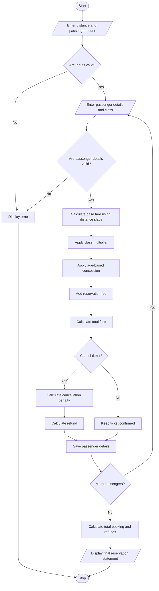

## 1. Problem Statement

Develop a Railway Fare and Reservation Calculator that calculates fares for multiple passengers based on travel distance, travel class, and age-based concessions. The system adds reservation fees, validates passenger details, calculates cancellation penalties and refunds, and generates a formatted reservation statement.

**Rules used:**
- **Distance slabs:** First 100 km at ₹1.50/km, next 200 km at ₹1.25/km, and distance above 300 km at ₹1.00/km.
- **Travel classes:** Sleeper (1×), AC 3 Tier (2×), AC 2 Tier (3×), and AC First Class (4×).
- **Age concessions:** Below 5 years—100% of travel fare; ages 5–11—50%; ages 60 and above—40%; other passengers—no concession.
- **Reservation fee:** ₹40 per passenger.
- **Cancellation penalty:** 25% of the discounted travel fare. The reservation fee is non-refundable.

*These are hypothetical academic-project rules, not actual railway fare or concession policies.*

## 2. Algorithm

1. Start.
2. Enter the travel distance and number of passengers.
3. Validate the distance and passenger count.
4. Enter each passenger's name, age, and travel class.
5. Calculate the base fare using distance slabs.
6. Apply the travel class multiplier.
7. Calculate the age-based concession.
8. Add the reservation fee.
9. Calculate the passenger's total fare.
10. Ask whether the passenger wants to cancel the ticket.
11. If cancelled, calculate the penalty and refund.
12. Repeat the process for all passengers.
13. Display the individual fare statements and total booking cost.
14. Display the total refund and net cost after refunds.
15. Stop.


## 5. Sample Input

```text
Enter travel distance (km): 350
Enter number of passengers: 2

Passenger 1
Enter passenger name: Ravi
Enter passenger age: 30
Enter travel class: Sleeper
Cancel ticket? (yes/no): no

Passenger 2
Enter passenger name: Lakshmi
Enter passenger age: 65
Enter travel class: AC 3 Tier
Cancel ticket? (yes/no): yes
```

## 6. Sample Output

```text
================================================
     RAILWAY RESERVATION STATEMENT
================================================

Passenger: Ravi
Age: 30
Travel Class: Sleeper
Base Fare: ₹450.00
Concession: ₹0.00
Reservation Fee: ₹40.00
Total Fare: ₹490.00
Status: Confirmed
Cancellation Penalty: ₹0.00
Refund: ₹0.00
------------------------------------------------

Passenger: Lakshmi
Age: 65
Travel Class: AC 3 Tier
Base Fare: ₹450.00
Concession: ₹360.00
Reservation Fee: ₹40.00
Total Fare: ₹580.00
Status: Cancelled
Cancellation Penalty: ₹135.00
Refund: ₹405.00
------------------------------------------------

Total Booking Cost: ₹1070.00
Total Refund: ₹405.00
Net Cost After Refunds: ₹665.00
================================================
```

## 7. Mermaid Flowchart Code


## 8. Conclusion

The Railway Fare and Reservation Calculator calculates fares for multiple passengers based on distance, travel class, and age. It applies concessions, includes reservation fees, validates inputs, calculates cancellation penalties and refunds, and produces a formatted reservation statement. The project demonstrates Python functions, loops, dictionaries, conditional statements, exception handling, and formatted output.
