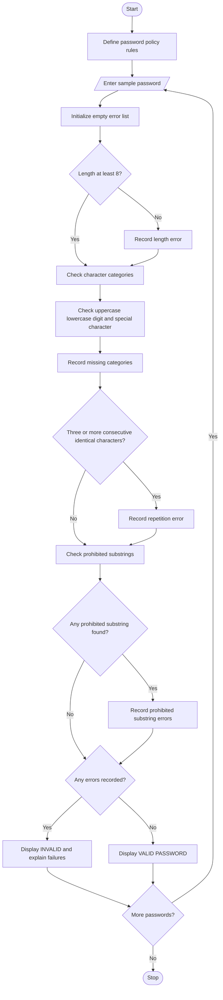

## 1. Problem Statement

Develop a Password Policy Validation Engine that evaluates sample password strings against predefined security rules. The system checks minimum length, character categories, repeated characters, and prohibited substrings. It identifies every failed condition and explains why the password does not satisfy the policy.

Password policy rules used in this project:

1. Minimum length: Password must contain at least 8 characters.
2. Character categories: Password must contain at least one uppercase letter, one lowercase letter, one digit, and one special character.
3. Repetition rule: Password must not contain the same character three or more times consecutively.
4. Prohibited substrings: Password must not contain prohibited words such as `password`, `admin`, or `123456` (case-insensitive).
5. Result: Display `VALID` if all rules pass; otherwise, display each failed condition with an explanation.

These rules are illustrative and can be adjusted to suit an assignment's requirements.

## 2. Algorithm

1. Start the program.
2. Define the minimum password length and prohibited substrings.
3. Enter one or more sample passwords.
4. Check whether each password contains at least 8 characters.
5. Check for uppercase letters, lowercase letters, digits, and special characters.
6. Check whether any character repeats three or more times consecutively.
7. Check whether the password contains a prohibited substring, ignoring letter case.
8. Record and explain every failed condition.
9. If no conditions fail, display `VALID PASSWORD`.
10. Otherwise, display `INVALID PASSWORD` and the reasons for failure.
11. Repeat for all passwords.
12. Stop the program.


## 5. Sample Input

```
How many passwords to test? 3

Enter sample password 1: Abc@1234

Enter sample password 2: abc

Enter sample password 3: Admin@123456
```

## 6. Sample Output

```
Password: Abc@1234
Result: VALID PASSWORD
All policy rules passed.
---------------------------------------------

Password: abc
Result: INVALID PASSWORD
Failed conditions:
- Password must contain at least 8 characters.
- Missing uppercase letter (A-Z).
- Missing digit (0-9).
- Missing special character (e.g., !, @, #).
---------------------------------------------

Password: Admin@123456
Result: INVALID PASSWORD
Failed conditions:
- Same character must not repeat 3 or more times consecutively.
- Contains prohibited substring: 'admin'.
- Contains prohibited substring: '123456'.
---------------------------------------------
```

Correction to the sample logic: `Admin@123456` does not contain a character repeated three or more times consecutively. Therefore, that repetition error should not appear. The correct output for that password contains only the two prohibited-substring errors.

## 7. Mermaid Flowchart Code 

## 8. How the Program Works

| Function or concept | Purpose                                            |
| ------------------- | -------------------------------------------------- |
| `len()`             | Checks password length                             |
| `isupper()`         | Checks uppercase letters                           |
| `islower()`         | Checks lowercase letters                           |
| `isdigit()`         | Checks digits                                      |
| `isalnum()`         | Helps identify special characters                  |
| `re.search()`       | Detects consecutive repeated characters            |
| `lower()`           | Makes prohibited-substring checks case-insensitive |
| `errors` list       | Stores all failed conditions                       |

## 9. Conclusion

The Password Policy Validation Engine checks password strings against length, character-category, repetition, and prohibited-substring rules. It reports every failed condition with a clear explanation, helping users understand why a password is invalid. This project demonstrates Python strings, lists, functions, loops, conditional statements, regular expressions, and input validation.
