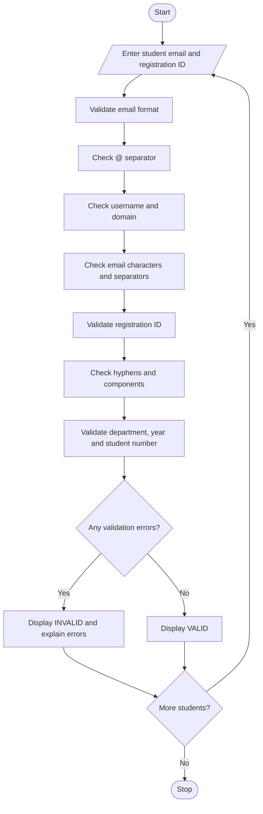

## 1. Problem Statement

Develop a Student Email and Identifier Validation System that checks student email-like strings and registration identifiers against predefined formatting rules. The system identifies malformed separators, invalid character groups, missing components, and incorrect identifier formats. It reports each validation failure with a clear explanation and displays whether each entry is valid or invalid.

Validation rules used in this project

Student email rules

- Must contain a username and a domain separated by exactly one `@` symbol.
- Username must not be empty.
- Domain must contain a name and an extension, such as `college.edu`.
- Username and domain may contain letters and digits; username may also contain dots, underscores, and hyphens.
- No spaces or consecutive dots are allowed.
- The domain must not start or end with a hyphen.

Registration identifier rules

- Format: `CSE-2026-0123`
- Must contain three components separated by exactly two hyphens.
- Department must contain 2–5 uppercase letters.
- Year must contain four digits.
- Student number must contain four digits.
- Missing components and invalid characters must be reported.

These are example rules for an academic assignment and can be modified to match your college's format.

## 2. Algorithm

1. Start the program.
2. Enter the student's email address and registration identifier.
3. Validate the email:
   - Check for exactly one `@` symbol.
   - Check for a non-empty username and domain.
   - Check for valid characters.
   - Check for malformed separators and missing domain components.
4. Validate the registration identifier:
   - Split the identifier using hyphens.
   - Check that exactly three components are present.
   - Validate the department, year, and student number.
   - Report missing components or invalid characters.
5. Display all validation errors.
6. If no errors are found, display `VALID`; otherwise, display `INVALID`.
7. Repeat for additional students if required.
8. Stop.


## 5. Sample Input

```
Enter number of students to validate: 2

--- Student 1 ---
Enter student email: yamuna.vemu@college.edu
Enter registration ID: CSE-2026-0123

--- Student 2 ---
Enter student email: yamuna@@college
Enter registration ID: CSE--12A
```

## 6. Sample Output

```
--- Student 1 ---

Email: yamuna.vemu@college.edu
Email Status: VALID

Registration ID: CSE-2026-0123
Registration Status: VALID
---------------------------------------------

--- Student 2 ---

Email: yamuna@@college
Email Status: INVALID
- Email must contain exactly one '@' separator.

Registration ID: CSE--12A
Registration Status: INVALID
- Year component is missing.
- Year must contain exactly four digits.
- Student number must contain exactly four digits.
---------------------------------------------
```

## 7. Mermaid Flowchart Code 

## 8. Important Python Concepts

| Concept          | Purpose                                         |
| ---------------- | ----------------------------------------------- |
| `split()`        | Separates email or identifier components        |
| `count()`        | Counts separators such as `@` and `-`           |
| `re.fullmatch()` | Checks whether text matches the required format |
| `if-elif-else`   | Applies validation conditions                   |
| Lists            | Store multiple validation errors                |
| Functions        | Separate email and registration validation      |
| `try-except`     | Handles invalid numeric input                   |

## 9. Conclusion

The Student Email and Identifier Validation System checks email formatting and registration identifiers against predefined rules. It detects missing components, malformed separators, invalid characters, and incorrect formats, explaining each failure separately. This project demonstrates Python strings, regular expressions, functions, lists, conditional statements, and exception handling.

Note: This program checks formatting only; it does not verify whether an email address or student registration number actually exists.
